# IRON experiments on a Ryzen AI NPU

One night (7 November 2026) of finding out what the NPU in an AMD Ryzen AI 7 PRO 350 laptop
(a ThinkPad; XDNA2, AMD codename Krackan Point, `xrt-smi` calls it "NPU Krackan") is good at,
programmed directly in IRON, the Python front end of AMD/Xilinx [mlir-aie](https://github.com/Xilinx/mlir-aie)
1.4.5, under Linux (openSUSE Tumbleweed, kernel 7.3 with the in-tree `amdxdna` driver). Demoscene
effects, physics simulations, audio DSP and one real object detector, each checked against numpy
and timed; plus the probes that measured the chip's ceilings, and every trap hit on the way.

Most of the code was written by [Claude Code](https://claude.com/claude-code) (Anthropic's agent)
working with Anne Jan Brouwer over one evening and night; every commit carries a `Co-Authored-By`
trailer saying so. All numbers are measurements on this one laptop, not AMD specifications, unless
a line says otherwise. See "Credits and licences" at the end for what is borrowed from whom.

Short version: the chip is 32 small vector cores with 64 KB each, fed by fast DMA. It shines on
anything branchless and MAC-shaped where every lane does the same work: stencils, convolutions,
FIR audio, int8 matrix multiplies, lookup tables. It is poor at gathers, trig, fp32 multiplies and
anything that needs a big table. A dispatch costs ~160 us before any work, so batch work per call.

## Setup

Hardware and kernel: a Ryzen AI 300 NPU (Strix Point, Krackan Point or Strix Halo; PCI `1022:17f0`),
Linux 6.14 or newer with the in-tree `amdxdna` driver (`CONFIG_DRM_ACCEL_AMDXDNA`) and the `amdnpu`
firmware (Tumbleweed: `kernel-default` + `kernel-firmware-platform`). `/dev/accel/accel0` is owned by
`root:render`, so add yourself to the `render` group. `lsmod | grep amdxdna` and `ls /lib/firmware/amdnpu`
tell you whether both are there.

XRT (AMD's runtime) is not in any distribution. This repo expects it unpacked, not installed, in
`../ryzenai` (nothing goes into `/opt`):

```
mkdir -p ../ryzenai/dl ../ryzenai/x && cd ../ryzenai
# into dl/: RAI_1.9_Linux_NPU_XRT.zip from AMD's "Ryzen AI Software 1.9, Linux" download page (AMD EULA), which holds
#   xrt_202620.2.26.89_24.04-amd64-{base,base-dev,npu}.deb and xrt_plugin.2.26.260102.59.release_24.04-amd64-amdxdna.deb,
# plus the two Ubuntu 24.04 packages the XRT binaries link against:
#   libboost-filesystem1.83.0_*.deb and libboost-program-options1.83.0_*.deb (packages.ubuntu.com)
for d in dl/*.deb; do dpkg-deb -x "$d" "x/$(basename "$d" .deb)"; done     # no dpkg? ar p X.deb data.tar.zst | tar -x --zstd
mkdir -p xrt boost
for p in x/xrt_*/opt/xilinx/xrt x/xrt_plugin*/opt/xilinx/xrt; do cp -a "$p/." xrt/; done
cp -a x/libboost*/usr boost/
```

`env.sh` points `XILINX_XRT`, `LD_LIBRARY_PATH` and `PYTHONPATH` (for `pyxrt`) at those two
directories. `pyxrt` is built for CPython 3.12 and the `mlir_aie` wheel is `cp312`, hence `python3.12`
in `setup.sh` (Tumbleweed: `zypper in python312`). Then, from this directory:

```
./setup.sh                      # clones mlir-aie v1.4.5 (no submodules), makes ironenv/ with mlir_aie 1.4.5,
                                # the pinned Peano (llvm-aie) compiler and the demo extras (~2 GB)
./env.sh xrt-smi examine        # the device: "NPU Krackan 1 | aie2p | 6x8"
```

## Quick start

```
./env.sh make -C mlir-aie/programming_examples/basic/vector_scalar_mul run_py   # smoke test, ends with PASS!
./env.sh python probe/plasma.py --window        # 1080p plasma in a pygame window
./env.sh python fun/mandel.py                   # Mandelbrot zoom in the terminal; --png out.png writes one frame
./env.sh python fun/lenia.py --window           # Lenia
./env.sh python fun/reverb.py --live            # microphone -> NPU convolution reverb -> headphones
```

Every command runs from this directory (the scripts find each other through `fun/` and `probe/`).
The first run of each design compiles its kernels (0.4-1.7 s, cached in `~/.npu/cache`,
`NPU_CACHE_HOME` overrides), and every `./env.sh` call runs `xrt-smi examine` once to find the device,
so starts take a moment. Run one NPU job at a time. `--window` needs pygame-ce; the audio demos need
soundfile and sounddevice, the live ones headphones.


## Pictures

| | | |
|---|---|---|
| 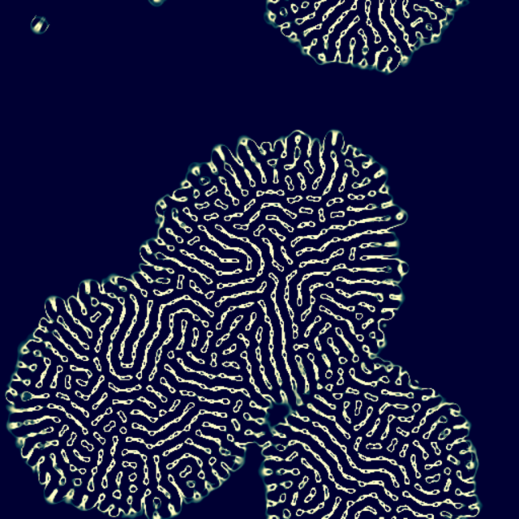 Lenia, 27x27 kernel | 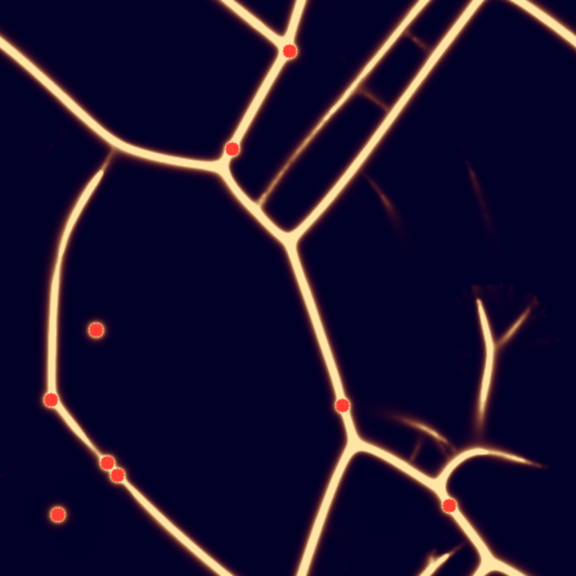 Physarum network | 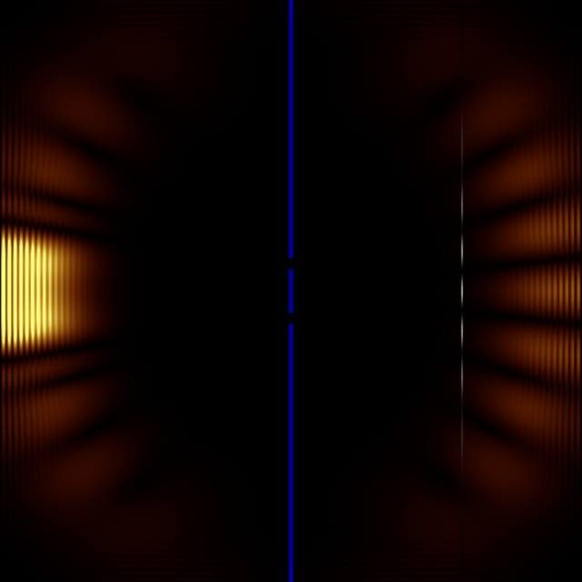 Schrodinger double slit |
| 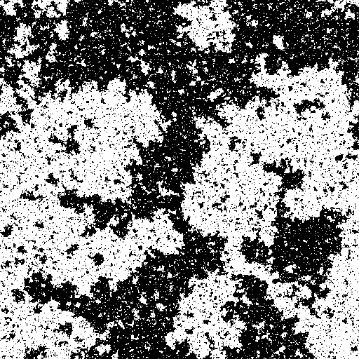 Ising at Tc | 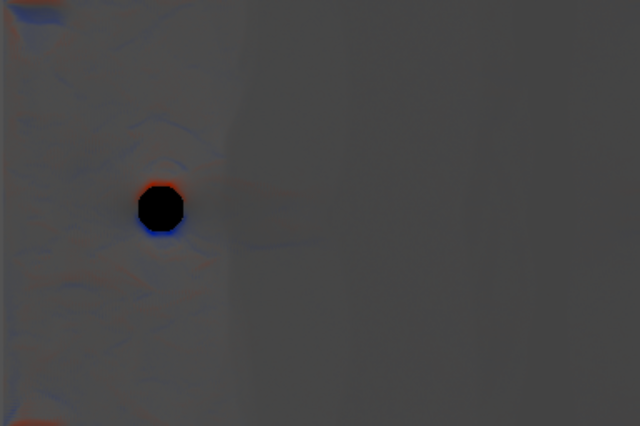 Lattice-Boltzmann vortex street | 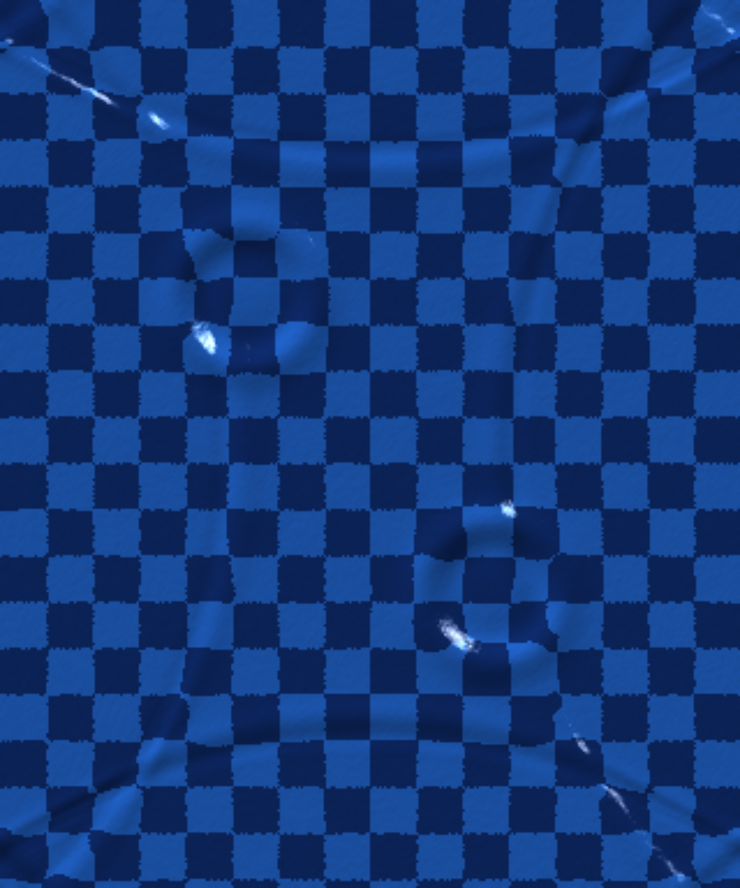 Ripple tank |
| 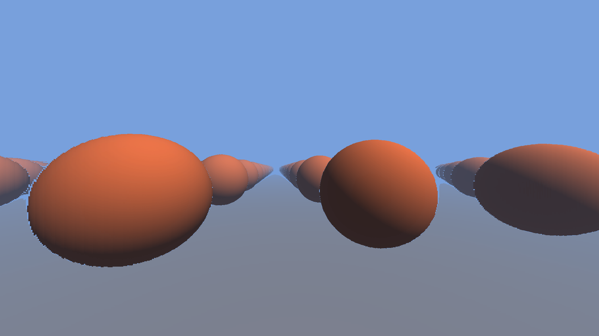 SDF sphere tracer | 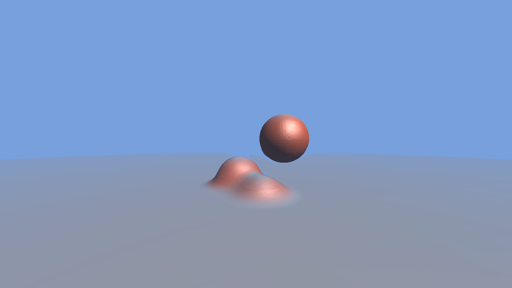 Smooth-min blobs | 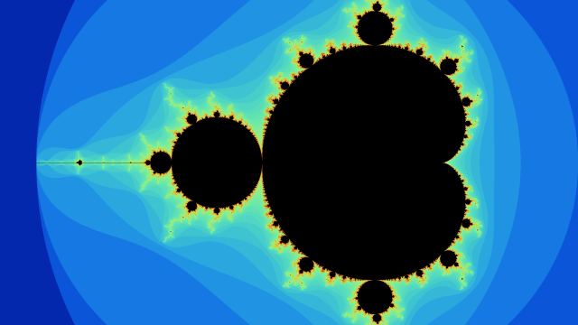 Mandelbrot, 32 cores |
| 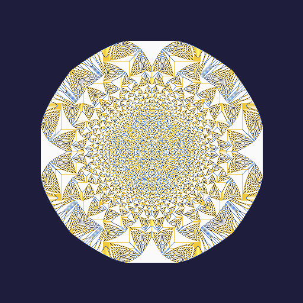 Abelian sandpile, 2^18 grains | 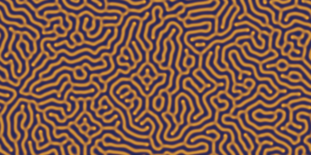 Gray-Scott coral | 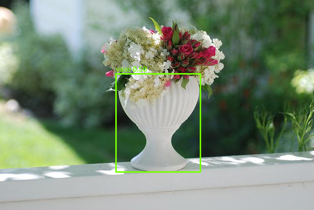 YOLO26n, 150 fps, real weights |
| 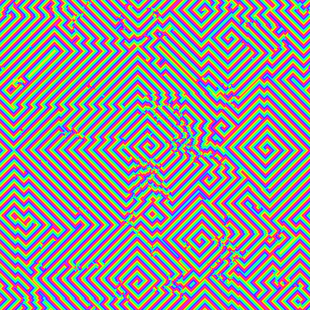 Cyclic CA demons | 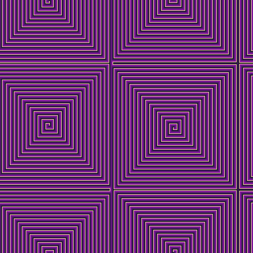 Greenberg-Hastings spirals | 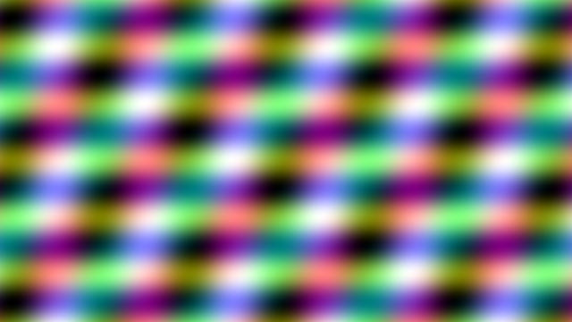 1080p plasma, 0.34 ms/frame |
| 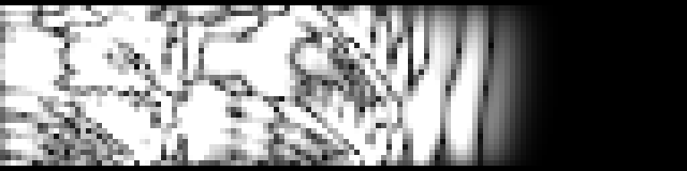 Corridor impulse response, 3-D FDTD | | |

(The YOLO picture is COCO 2017 image 30: photo by julie, https://www.flickr.com/photos/roosterfarm/3573516590, CC BY 2.0, boxes added.)

## Hardware (xrt-smi: "NPU Krackan 1", aie2p, 6x8)

| | |
|---|---|
| Compute cores | 32 (8 columns x rows 2..5), 1.76 GHz |
| Per core | 64 KB data memory (4 banks of 16 KB), 512-bit vector unit, 2 DMA in + 2 out |
| Mem tiles | 8 (row 1), 512 KB each |
| Shim tiles | 8 (row 0), 2 DMA channels each way, host DDR access |
| Vector lanes | 64 x int8, 32 x int16, 16 x int32, 32 x bf16 |
| Native math | int add/mul/mac/shift/cmp/select/shuffle, bf16 mul, `aie::inv`, `aie::invsqrt`, `aie::sqrt`, `aie::exp2`, `aie::tanh` (bf16) |
| Not native | float vector multiply (emulated via bf16, ~50 bundles/vector), scalar float mul/div, int32 divide, 64-bit multiply, sin/cos (use tables / polynomials), per-lane gather |

Sources: the name and the 6x8 array from `xrt-smi examine`; tile memories, DMA channels and lane
widths from the AIE-ML v2 (aie2p) architecture documentation and `mlir-aie/programming_guide/section-1`.
AMD does not publish the clock: ~1.76 GHz is what the II-1 loop in `probe/burn.py` implies, and
`probe/npu_top.py` reads the driver's H clock. "Native" means Peano compiles it to vector
instructions rather than a library call.

## Measured ceilings (2026-11-07, `probe/`)

All numbers: this one laptop, Linux, XRT 2.26, mlir-aie 1.4.5, default power mode, CPU idle unless
stated, min or median after a warm-up call, host wall clock from Python unless the row says NPU time.
"1080p" frames are 1920x1088 (32 cores x 34 rows) cropped to 1080.

| What | Number |
|---|---|
| Dispatch floor, host wall clock | ~155-180 us per call |
| Host <-> NPU DMA, all 8 columns, in and out at the same time | ~31 GB/s each way = 63 GB/s aggregate at 64 MB, 21 GB/s each way at 8 MB; a second shim channel per column or 64 KB objects change nothing (`probe/bw2.py`; `probe/bw.py` with one channel and 16 KB objects: 26 GB/s). ghost-intuit report 52-98 GB/s one way on a Strix Point under Windows |
| 1920x1088 RGBA frame out | ~0.31 ms |
| One core, int16 vector mul loop at II 1 | ~52 G elements/s (ideal 56) (`probe/burn.py`) |
| All 32 cores, same loop, wall clock incl. floor | ~850 G int16 ops/s |
| 1080p plasma, 32 cores, packed RGBA, bit-exact | 0.34 ms/frame (`probe/plasma.py`) |
| On-chip Game of Life, 32 cores | 27.8 Gcell/s vs numpy 1.5 (`fun/life_chip.py`) |
| Rotozoomer / tunnel 1080p, scalar texture gathers, 32 cores | ~1.1 ms/frame (`fun/rotozoom.py`) |
| SDF sphere tracer 1080p, bf16 MAC + fp32 accumulators, 32 cores | 48 steps 7.1 ms (141 fps), 64 steps 8.3 ms (120 fps), 96 steps 11.4 ms (88 fps) (`fun/sdf.py --steps N`) |
| Blobs 1080p, 4 spheres + floor smooth-min, 48 steps, 5 distance evals per step | 38 ms/frame, 26 fps (`fun/blob.py`) |
| Slime chemotaxis 320x256, bf16, world on chip, 15 steps/dispatch | 41k steps/s, 3.4 Gcell-steps/s (`fun/slime.py`) |
| Ripple tank 320x384, int16 Q12, world on chip, 5 steps/dispatch | 17k steps/s, 2.1 Gcell-steps/s (`fun/water.py`) |
| Convolution reverb, 65536 taps, 2048-sample blocks, stereo | 0.43 ms NPU per block per channel (43 ms of audio), 308 GMAC/s in the calls; 41x real time over the whole Python loop on a stereo file, bit-exact vs FFT (`fun/reverb.py`) |
| Lenia 512x512, 27x27 kernel (729 taps/cell), int16 Q15 | 0.65-0.84 ms/step, 1200-1500 steps/s, ~250 GMAC/s, conv exact to 6 LSB (`fun/lenia.py`) |
| Additive synth, 3072 partials, 1024-sample blocks | 0.38 ms per block (21 ms of audio: 56x real time for all 3072 partials) = 8 G partial-samples/s, amplitude drift-free, 0.03 Hz tuning (`fun/additive.py`) |
| Binaural, 32 sources x 2 ears x 160 taps, 1024-sample blocks | 0.28 ms per block (dispatch-bound), bit-exact, 38x real time (`fun/binaural.py`) |
| conv2d engine 512x512: K=3 / 7 / 15 | 0.27 / 0.35 / 0.91 ms per pass, 1-4 LSB vs numpy (`fun/conv2d.py`) |
| Physarum 120k agents + NPU blur | 13.8 ms/step total, NPU 0.7 ms of it (the agents are the cost) (`fun/physarum.py`) |
| Ising 512x512, 20 half-sweeps per dispatch | 2-3 G spin-updates/s (7-11k sweeps/s); |M| and E within 1% of Onsager at T = 1.5..3.5 (`fun/ising.py`) |
| YOLO26n (stock example), whole network on 32 tiles, batch 1 | **6.5 ms per 640x640 image = 150 fps** with the real XINT8 weights, 8/8 coco128 images bit-exact vs the integer oracle and ONNX Runtime, mAP50 0.97 on those 8. The same network measured 11.3 ms earlier, with seeded weights while the export saturated the CPU (see the CPU-load note) |
| 2-D Schrodinger 512x512, int32, 1 step/dispatch (R for 3 rows + I for 1 per output row) | 0.47 ms/step, 2100 steps/s; norm conserved to 0.3% over 1400 steps (`fun/schrodinger.py`) |
| Sandpile 512x512, 101 rounds/dispatch | 90k rounds/s (2^18 grains stable in 50k rounds = 0.6 s), grains conserved exactly (`fun/sandpile.py`) |
| Cyclic CA / Greenberg-Hastings 512x512, int16, 21 steps/dispatch | 45k / 39k steps/s = 12 / 10 Gcell-steps/s, bit-exact (`fun/spiral.py`) |
| Gray-Scott 512x256, 101 steps/dispatch | 4300 steps/s, 0.6 Gcell-steps/s (`fun/grayscott.py`) |
| 3-D wave FDTD 32x32x128 (131k cells), int32, 1 step/dispatch | 0.21 ms/step NPU, 0.26-0.31 ms incl. host readback: 1 s of 8 kHz room response in 2.5 s (`fun/room.py`) |
| LBM D2Q9 384x256, bf16 deviations, 1 step per dispatch (DMA-bound) | 2700 steps/s, 0.27 Gcell-steps/s (`fun/lbm.py`) |
| Mandelbrot 1080p, 400 iterations, Q24 int32, 16 lanes, 32 cores | 26.9 ms (numpy 5.4 s); the old scalar int64 kernel is 34x slower per core, both measured at 480x270 on 32 cores (`fun/mandel.py --bench`) |

Rule of thumb for effects: a dispatch costs ~160 us before any work, a full-HD frame
costs ~0.3 ms of DMA, and compute is almost free unless the kernel is scalar.
Batch work per dispatch; keep one call per frame.

## Demos (`fun/`)

| | |
|---|---|
| `mandel.py` | zoom in the terminal; `--bench`, `--png out.png`, `--scalar` for the old kernel |
| `life.py`, `life_chip.py`, `life_window.py` | Game of Life, host-halo and on-chip (snake of 32 cores) variants, pygame window |
| `rotozoom.py` | rotozoomer + tunnel, `--window` (TAB switches) |
| `sdf.py` | sphere-traced signed distance field (repeated spheres + floor), `--window`, `--check` for the static loop report |
| `blob.py` | four spheres + floor joined with smooth-min (the "bloep", Dutch for the plop of merging blobs), numeric normals, specular; reuses sdf.py's plumbing |
| `slime.py` | slime mould / ant trails as grid chemotaxis (density + pheromone, conservative upwind flux), on-chip world, `--window` (click = food) |
| `water.py` | ripple tank, int16 Q12 height field, on-chip world, `--window` (drag = drops, R = rain) |
| `reverb.py` | convolution reverb: 65536-tap IR (1.4 s), 2048 taps per core, int16 Q15, `sliding_mac` FIR; `in.wav` offline with numpy check, `--play` live through the speakers, `--live` microphone -> headphones (3% load) |
| `lenia.py` | Lenia continuous CA: 27x27 ring-kernel convolution per step via `sliding_mac`, DDR world streamed through the cores with a 27-row ring buffer in L1, bf16 growth; `--window` |
| `room.py` | 3-D FDTD room acoustics (32x32x128 cells, int32 Q28, 8 kHz), streams z-planes through the cores, records a stereo impulse response; `--check` vs numpy |
| `binaural.py` | 32 sources around the head, one per core, MIT KEMAR HRTFs (Gardner & Martin 1994, downloaded to `data/kemar/` on first run), two `sliding_mac` FIRs per core; writes `binaural_arpeggio.wav`, `--play` live |
| `conv2d.py` | generic K x K convolution engine over a DDR world (the Lenia machinery parameterised), self-test vs numpy |
| `physarum.py` | real slime-mould networks (Jones 2010 agents on the CPU, trail blur + decay on the NPU via conv2d) |
| `ising.py` | 2-D Ising, checkerboard Metropolis, xorshift32 RNG in the lanes, world on chip; |M| and E vs Onsager's exact solution; `--window` (up/down: temperature) |
| `yolo_cam.py` | YOLO26n object detection on the webcam or an image, via the stock `mlir-aie/programming_examples/ml/yolo26n`. Needs its exported weights: follow that example's README (`make export`, `make data` with `IRON_EXAMPLE_WEIGHTS_DIR` set; the Ultralytics checkpoint is AGPL and not in this repo; ~25 min of calibration). `--synthetic 7` runs without a checkpoint (timing real, boxes noise) |
| `schrodinger.py` | 2-D Schrodinger equation, Visscher scheme, int32 Q28, 5-row sliding window; a wave packet through a double slit; `--check` vs numpy |
| `sandpile.py` | Abelian sandpile, exact int16 stencil on chip, 2^18 grains (the default; 2^19 runs off the 512 grid) dropped in portions (abelian), the fractal in `sandpile.png` |
| `grayscott.py` | Gray-Scott reaction-diffusion, int16 Q14, world on chip; `--F --k` or live keys through Pearson's map |
| `water_resident.py` | the ripple tank with its world resident in L1 across dispatches (`Buffer` + `while_true` workers, one command object per call); measures the DDR saving and the autosuspend reset |
| `additive.py` | additive synthesiser: 3072 partials as magic-circle oscillators, 32 samples of each sinusoid in the lanes, one rotation per sub-block, no trig; bells and STFT resynthesis to wav, bit-exact numpy replica |
| `spiral.py` | integer excitable media on chip: cyclic CA (16 states, demons) and Greenberg-Hastings (8 states, spiral waves), bit-exact vs numpy |
| `lbm.py` | Lattice-Boltzmann D2Q9 fluid, flow past a cylinder; world in DDR, streamed through all 32 cores every step, shim DMA gathers the halo rows with a 3-D pattern, cores use a 3-row sliding window (`acquire(3)`); `--window` (drag = obstacles, C = clear) |
| `fft.py` | the attempt at a batched FFT; kept as a design, its kernel does not compile on AIE2P/Peano (see the FFT section) |
| `patterns.py` | RLE helper with the classic Life objects for `life_window.py` (no main) |
| `probe/plasma.py` | 3-sine plasma, `--window` |
| `physarum_route.py` | slime-mould router for KiCad boards (Tero's Physarum solver, every net a tube network competing for space); `--window` / `--video` show the tubes grow, `--write-pcb` writes the tubes as tracks and vias into a copy of the board (opens in KiCad), `--write-pro` writes topor priority net classes. CPU only (sparse direct solves), see the section |

## Probes (`probe/`)

| | |
|---|---|
| `npu_top.py` | live NPU telemetry straight from the amdxdna driver (`/dev/accel/accel0` ioctl): clocks, power mode, hardware contexts; no root, no XRT; `--watch 0.5 --count N` |
| `bw.py`, `bw2.py` | host <-> NPU DMA bandwidth and the dispatch floor (one vs two shim channels per column) |
| `burn.py`, `burn2.py`, `sustain.py`, `clock_under_load.py` | per-core compute ceiling (II-1 vector loop), kernel variants, implied clock, long vs short calls, clock under CPU load |
| `plasma.py` | 1080p plasma on 32 cores, the frame-output template; `--window` |
| `lut.py` | `aie::parallel_lookup` against a scalar gather loop (palettes, textures) |
| `fir_check.py`, `fir_floor.py`, `fir_alt.py`, `gs_check.py`, `ising_check.py` | static schedule (II, libcalls, stack) reports for the FIR, Gray-Scott and Ising kernels; where the reverb's time goes |
| `lbm_check.py`, `lenia_dbg.py`, `lenia_dbg2.py`, `room_decay.py`, `room_rounding.py`, `slime_stats.py` | the debugging runs behind the lessons in this README (numpy emulations of rounding, mass and energy checks) |

Shim DMA budget: each column's shim has 2 channels in and 2 out, so a design that gives every
core its own host stream cannot go past 1 worker per column (`transform_parallel_binary` with
`num_channels=4` fails placement). Pack inputs into one stream and fan out through the memtile
(`split` on the way in, `join` on the way out); the memtile has 6 DMA channels each way, so two
splits plus a join is already too many.

## What fits this chip, demo-wise

Good: anything branchless and MAC-shaped where every lane does the same work and data stays
on chip. Stencils (Life, reaction-diffusion, fluids), convolution filters, vertex transforms,
FFT (`aie::fft_dit`), tiny per-pixel neural nets, and SDF ray marching: the whole march is
bf16 multiplies into fp32 accumulators (native), `invsqrt`/`inv`/`min`/`max`/`select` in bf16
(native), fp32 adds for the ray position (native). Keep fp32 values in `aie::accum<accfloat>`
and convert to bf16 only for the multiplies; round-to-grid with the magic-number trick in
fp32 adds (`p + 1.5*2^25 - 1.5*2^25` rounds to a multiple of 4), never through bf16.

Poor: per-pixel gathers (texture lookups, palettes: scalar unit, one per cycle), anything needing
a big table or framebuffer in L1 (64 KB), fp32 multiplies, divides, trig, branchy per-pixel code.
Trivial effects (plasma) are DMA-bound: writing the frame costs more than computing it.

A ray-march step for 32 pixels is ~80 bundles with two rays interleaved (one ray alone: ~157;
the chain is latency-bound, `ns` 1). Peano exposes five 512-bit accumulator registers on AIE2P, so
more rays in flight spill to the stack (visible in the remarks).

Precision lessons from `sdf.py`, each one cost a wrong picture:
* a bf16 ray direction is too coarse (8 mantissa bits: neighbouring rows share a direction and
  silhouettes terrace). Split it into bf16 hi + lo parts and march with two `mac`s;
* no hit test = grazing rays that ran out of steps get shaded as the surface. Test the final
  distance against an eps that grows with t, else sky;
* clamp the step. Unbounded steps push p past 2^24, the magic-number rounding breaks and the
  lane turns NaN, which `to_fixed` makes black;
* numeric normals from bf16 distances come out as moire rings. Subtract the fp32 accumulators
  (eps 0.08), and keep the squared gradient away from 0: a sky ray's flat gradient gives
  `invsqrt(0) * 0` = NaN, which `to_fixed` made white.

On-chip stencil sims (`slime.py`, `water.py`, after `life_chip.py`): the world lives in the 32
cores' L1 (about 48 KB each after edge buffers: 1.5 MB in all), every step hands one row up and
one down through shared memory, and one dispatch runs many steps. Lessons:
* `accum::to_vector<bf16>()` and `to_vector<int16>(shift)` round with the core's rounding-mode
  register, which defaults to **truncation**. A conservative scheme then loses mass every step
  (0.3% per step in the slime sim). Call `aie::set_rounding(aie::rounding_mode::conv_even)`
  at the top of the kernel;
* bf16 cannot integrate `h += v` when v is far smaller than h (8 mantissa bits): ripples
  freeze. Height fields want int16 fixed point, the Amiga way;
* a ping-pong world buffer only keeps what the kernel writes: a constant field (food) that
  rides along in the band must be copied by the kernel each step;
* the memtile takes one split plus one join per column; a second input stream per core does
  not fit, so pack all per-cell fields into one band.

LBM lessons (`lbm.py`): store distributions as deviations from rest (`f_i - w_i`) or bf16 has no
precision left; a body force small enough to be stable vanishes in bf16, so drive the flow with an
inlet boundary the host rewrites between steps; start from rest and ramp the inlet (an impulsive
start shocks rho by 20% and bf16 noise then blows up); `aie::neg` on a bf16 vector is not
legalised by Peano (multiply by -1 instead). Nine fields per cell do not fit L1 with a useful world,
so the world lives in DDR: one step per dispatch, ~0.26 ms, all of it DMA and fixed cost.

## Beyond demos: audio

`fun/reverb.py` is the first non-demo use and the best fit so far: a long FIR is nothing but
multiply-accumulates on int16, no gathers, no branches. 65536 taps at 48 kHz is 3.1 GMAC/s per
channel; the chip does 308 GMAC/s in the dispatch (one `sliding_mac<32, 8>` per 8 taps for 32
outputs, 87 bundles per 32 taps per core; the naive unaligned-load version reaches 207), so a
stereo 1.4 s reverb costs 2% of real time in 43 ms blocks. The same shape covers cabinet
simulation, HRTF/3D audio (dozens of FIRs), filter banks and channelizers; `aie::fft_dit` is there
for spectral effects, and int8 matmul for neural audio (denoise, amp models). Dispatch cost
(~160 us) is 8 samples at 48 kHz, so 256-512 sample blocks are fine for live use.

Benchmark trap: the first call of a design loads (or compiles) it and costs 0.4-1.7 s. Time
after a warm-up call, or the throughput number is garbage (the first version of this bench
reported 16 GMAC/s for that reason).

## Big-kernel convolution (Lenia)

`fun/lenia.py` is the pattern for any wide stencil or 2-D convolution: the world lives in DDR,
each core receives its band plus K-1 halo rows through one 3-D shim DMA pattern, keeps the last K
rows in a static ring buffer in L1 (27 x 1.2 KB) and emits one output row per input row once the
window is full; per output vector it runs K x 4 `sliding_mac<32, 8>` (one int32 accumulator),
then an elementwise bf16 pass (growth function with `aie::exp2`). Two lessons that cost a wrong
picture each:
* **`aie::load_v` / `aie::store_v` on an address that is not 64-byte aligned silently rounds the
  address down** (to the previous 32-element boundary). No error, no warning: the picture was
  shifted by 13 columns. Use `load_unaligned_v` / `store_unaligned_v` wherever the offset is not a
  multiple of 32 elements, and lay the world out so the hot loads are aligned (here the data
  window starts at `x + 32`, the output at `x + 45`).
* **Static variables in a kernel persist across dispatches.** The ring buffer's head/fill counters
  were left over from the previous call. Reset them explicitly at the start of each dispatch
  (a `produce = -1` mode) rather than relying on fresh `.bss`.
* Keep the int32 accumulator in range: sum(k) = 1 scaled by 2^16 times 32767 just fits; 2^19
  overflowed. And subtract in int16 before converting to bf16 when the next step is a sharp
  Gaussian (sigma 0.015): bf16(u) alone has 8 mantissa bits.

## State resident on the chip across dispatches

`fun/water_resident.py`: each worker keeps its two band buffers as `Buffer`s in L1 and runs its
default `while_true` loop, one iteration per dispatch, gated by acquiring a 32-int command object
from a broadcast ObjectFifo (drop x, y, amplitude); it then runs an even number of steps and
pushes only its h rows out. It works: the world carries over from call to call (same energy as
`water.py` after 80 steps, small rounding-level differences, rms 7 LSB). But at this size it
buys nothing: 0.221 ms per call against 0.230 ms with the whole world through DDR, because the
1 MB round trip is ~10 us next to the ~160 us dispatch floor. Resident state only pays for worlds
of many MB. And the catch: **after 5 s idle amdxdna suspends the device and the cores come back
reset** (measured: energy 0.357 -> 0.000 after a 6.5 s pause), so a resident design needs a
keep-alive call every few seconds or must re-upload after a pause (the upstream example
`mlir-aie/programming_examples/ml/llama_3_2_1b/README.md` says the same; `/sys/class/accel/accel0/device/power/autosuspend_delay_ms` is the knob, root only).

## The lookup unit: gathers after all (for tables)

`probe/lut.py`: `aie::parallel_lookup` on a `aie::lut<4>` table (entries stored run-duplicated: runs
of 16 x 16-bit or 8 x 32-bit values written twice, in two copies) returns 16 looked-up values per
`fetch` of 16 indices. Applied 200 times to a 512x512 index image on all 32 cores:

| table | scalar `out[x] = pal[in[x]]` | parallel_lookup |
|---|---|---|
| 256 x int32 (RGBA palette) | 6.6 G lookups/s | 24.5 G lookups/s |
| 4096 x uint16 (a 64x64 RGB565 texture) | 5.2 G lookups/s | 24.6 G lookups/s |

(measured with the CPU saturated by a model export, so absolute numbers are low; the ratio holds.)
Four times the scalar unit, independent of table size, exact. Palettes, sin/cos tables, small
textures and transfer functions belong in L1 as LUTs, not in scalar loops: the rotozoomer and
tunnel would run about 4x faster this way. Limit: the table lives in L1 four times over
(2 copies x 2 tables), so 4096 x 16-bit is 32 KB.

## Ising with a random number generator in the lanes

`fun/ising.py`: spins as int16 on the chip (slime.py layout), one call = 20 half-sweeps; each half-sweep
updates one checkerboard colour with Metropolis. The random numbers are a per-core xorshift32 on two
16-lane int32 vectors (logical right shift = arithmetic shift + mask), 15 bits per spin, state kept in
static L1 across calls (here persistence is a feature). The flip decision is three masks: dE <= 0, or
dE = 4 and rnd < exp(-4/T), or dE = 8 and rnd < exp(-8/T); thresholds are compile-time constants, so
each temperature is a variant. Checked against Onsager: |M| 0.9869 vs 0.9865 at T = 1.5, 0.794 vs
0.785 at T = 2.2 (started ordered; a quench from random needs far more than 2000 sweeps to order a
512x512 lattice), energy within 0.3% at every T, critical clusters at Tc = 2.269 in `ising.png`.
2-3 G spin updates per second.

## YOLO26n: the stock example runs here

`mlir-aie/programming_examples/ml/yolo26n` maps the whole YOLO26n detector (168 int8 operators) onto
all 32 tiles in one dispatch. On this Krackan with the real weights (`export_yolo26n.py` +
`gen_yolo_data.py`: torch CPU, ultralytics and amd-quark pip-install fine; the quantization
calibration takes ~25 minutes of all cores): 8/8 coco128 images bit-exact against the integer oracle
and ONNX Runtime, mAP50 0.97 on those 8, **6.5 ms per image on the NPU, 150 fps at batch 1**.
`fun/yolo_cam.py` adds the webcam/letterbox/drawing (`--image`, `--still`, `--window`). Earlier, with
seeded weights while the export was calibrating on all CPU cores, the same network measured 11.3 ms:
see the CPU-load note below.

## Physarum, the honest version

`fun/physarum.py` is the slime mould the grid chemotaxis in `slime.py` could not be: 120k agents
sense three points ahead, turn, move and deposit (numpy, `bincount` for the scatter), and the NPU
blurs and decays the trail map every step through `fun/conv2d.py` (3x3 mean, x0.92). Nine food
sources deposit constantly; after 1500 steps the agents have laid a tube network between them
(`physarum.png`). The NPU does 0.7 ms of the 13.8 ms step: the gather/scatter half of the
algorithm is CPU work, and no amount of NPU makes it otherwise.

## Binaural (HRTF) rendering

`fun/binaural.py`: one sound source per core; per 21 ms block each core gets the source's history
window and the left/right head-related impulse responses for its current direction (MIT KEMAR
compact set: 37 azimuths at 0 degrees elevation, 128 taps at 44.1 kHz, resampled to 48 kHz,
mirrored for the left half, interaural delay included), runs two FIRs and returns two int32
partials the host sums. The demo is 32 plucked notes around a pentatonic ladder, triggered in
turn around a slowly turning ring: listen with headphones. The arithmetic is small (37 GMAC/s),
so this one is bound by the 160 us dispatch; it would be the same at 300 sources.

## Oscillators without trigonometry: time in the lanes

`fun/additive.py`: a partial is a 32-lane int16 vector pair holding 32 consecutive samples of its
sinusoid (u) and the Gordon-Smith companion (v). One sub-block of 32 samples later the whole vector
has rotated by theta = 32 w, the same constant in every lane: u' = u + e v, v' = v - e u', e = 2
sin(theta/2) in Q13. That update has determinant 1 for any quantised e, so the amplitude cannot
drift (measured: identical first and last second over 10 s); only the host computes a sine, once,
to seed the lanes. 96 partials per core, 32 cores: 3072 partials, per 1024-sample block 32
rotations and one amplitude-ramped multiply-accumulate each, 0.38 ms. Two subtleties: cos is even,
so e alone does not tell theta from 2 pi - theta (seed the lanes on the branch of theta mod 2 pi),
and Q15 cannot hold 1.0, so "no decay" must skip the multiply (32767/32768 per sub-block is -3% in
10 s). Demos: bells (inharmonic partial sets with per-partial decay) and a drum loop resynthesised
from its STFT magnitudes with one partial per bin.

## Room acoustics -> impulse response -> reverb (a chain)

`fun/room.py` simulates a 2.7 x 2.7 x 11 m hard-walled corridor with the 3-D wave equation (7-point
stencil, leapfrog, lambda = c dt/dx = 0.5, dx 8.6 cm at 8 kHz), injects a pulse and records two
"ears" 8 m away for one second; `room_ir_48k.wav` is that impulse response resampled, and

```
./env.sh python fun/room.py
./env.sh python fun/reverb.py <drums.wav> --ir room_ir_48k.wav --wet 0.5
```

plays the drum loop in the simulated corridor (the script writes `<drums>.reverb.wav`; any 48 kHz
loop will do, ours was a 200 bpm breakbeat; RT60 about 1.7 s, -30 dB after 0.85 s). 8000 steps take 2.5 s; the NPU dispatch is 0.21 ms of the 0.31 ms
loop, the rest is reading the field back to pick two samples.

Lesson: **int16 is not enough for a second-order wave update.** In int16 Q14 the field died
within 100 ms (energy -30 dB at 70 ms); a numpy emulation with exact round-to-nearest did the
same, truncation killed it faster, floor made it grow. The Laplacian term of a wave at tens of
LSB rounds to nothing. int32 Q28 (`aie::mul(int32 vector, int16 scalar)` into `acc64`, 16
lanes) matches the float reference's energy to 2% over 1500 steps. Rule: integrators and wave
equations want 24+ fraction bits; use int32, or bf16 only for quantities that are re-derived
every step (LBM's distributions, Lenia's world).

## FFT: not in aie_api on this toolchain

`aie::fft_dit_r4_stage` and friends compile only for AIE1; AIE2P has the class form, but
`detail/aie2p/fft_dit.hpp` sits behind `__AIE_API_COMPLEX_VECTOR_SUPPORT__`, which
`detail/config.hpp` sets to 0 whenever `__AIECC__` (Peano) is defined. No `cint16` vectors, no
FFT (`fun/fft.py` is the attempt; it fails at compile time). Options: a hand-written radix-2/4
on separate int16 re/im vectors, or a DFT as an int16 matmul (W is 2048x2048 for 1024 complex
points; batches of frames make it a wide GEMM, which this chip likes, but the acc32 sum of 2048
Q15 products needs the output shift the stock kernel does not expose).

## Dense matmul: how much of AMD's rated 50 TOPS the stock example gets

`mlir-aie/programming_examples/basic/matrix_multiplication/whole_array/whole_array.py`, 8 columns,
int8 in and out, NPU time from the example's own benchmark (2026-11-07):

| shape | tile m,k,n | TOPS | of 50 |
|---|---|---|---|
| 1024^3 | 64,64,32 (default) | 3.5 | 7% |
| 2048^3 | 64,64,32 | 3.9 | 8% |
| 2048^3 | 64,64,64 | 8.8 | 18% |
| 2048^3 | 128,64,64 | 15.8 | 32% |
| 2048^3 | 128,32,128 | 16.9 | 34% |
| 4096^3 | 128,64,64 | 14.6 | 29% |
| 2048^3 int16 | 128,32,64 | 6.1 | 12% (AIE-ML v2: int16 is 128 MAC/cycle per tile, a quarter of int8's 512) |

The default tiles are DMA-bound; bigger output tiles (more MACs per byte moved) give 4x. Larger
still does not fit: A, B and C tiles double-buffered must stay under 64 KB per core
(`'aie.buffer' op could not be placed`). The ghost-intuit write-up (next section) reached 60% on a
conv net with hand-written kernels and all 32 tiles per layer, so ~34% is the stock-example ceiling,
not the chip's. 50 TOPS is AMD's int8 rating for the Ryzen AI 300 NPU, not a measurement here.

```
./env.sh python mlir-aie/programming_examples/basic/matrix_multiplication/whole_array/whole_array.py \
    -M 2048 -K 2048 -N 2048 -m 128 -k 32 -n 128 --n-aie-cols 8 --dtype_in i8 --dtype_out i8
```

## From ghost-intuit/xdna2-npu-experiments (Strix Point, Windows, same silicon family)

Read 2026-11-07, https://github.com/ghost-intuit/xdna2-npu-experiments (CC BY 4.0). Their numbers are
from a Strix Point under Windows; each bullet says what was theirs and what was measured here.
* **NPU power mode (theirs, then here).** `xrt-smi configure --pmode performance` raised the core clock from 1.40 GHz
  (default) to 1.81 GHz on their part. On this Linux box the ioctl needs root
  (`DRM_IOCTL_AMDXDNA_SET_STATE ... Permission denied`); try
  `sudo ../ryzenai/xrt/bin/xrt-smi configure --pmode performance` before compute-bound demos,
  and `--pmode default` after. Turbo did not help them; disabling CPU idle states made everything slower.
  Measured here (2026-11-07): **no clear effect on this Linux/Krackan box.** A proper A/B with
  `probe/sustain.py` (same session, back to back): long 5 ms `burn` calls 5.35-5.64 ms in default
  vs 5.14 ms in performance, short 0.5 ms calls 512-659 vs 511 us: 4-9%, inside the run-to-run
  noise. The ray marchers and Mandelbrot did not move at all, and the SDF slope per march step
  (164k cycles per core in ~0.09 ms) implies ~1.8 GHz in both modes. An earlier "default" burn
  figure of 630 us was a cold first run, not the mode. Their 1.40 GHz default was measured on
  Windows; the Linux amdxdna driver appears to run near the top clock under load already. Setting
  the mode needs root (`./pmode.sh performance|default` wraps the sudo and library path).
* **CPU load throttles the NPU (here)**: with a model export saturating the CPU (load 24)
  `probe/npu_top.py` showed the H clock settling at 1150-1190 MHz under a sustained NPU load and
  the II-1 burn implied 0.96 GHz, against ~1.7 GHz with the CPU idle; YOLO26n took 11.3 ms instead
  of 6.5 ms. Keep the CPU quiet when timing, or when it matters.
* **Fixed cost per call ~100 us (theirs)** (89-95 us with no array activity), measured by trace: the
  on-device part of the ~155-180 us we see from Python, the rest being XRT and Python on the host.
  One call per frame; batch steps.
* **Heavy CPU load slows the NPU's data movement by up to 59% (theirs)** (shared power budget, lower
  fabric clock). A pygame loop that burns CPU on drawing slows the NPU it is timing. Pin the host
  process and keep the CPU quiet when measuring.
* **int8 matmul is the chip's real peak (theirs)**: 8x8x8 `mmul` = 512 MAC/cycle/tile, sustained 338-382;
  bfp16 (block floating point, shared 8-bit exponent) 261-274; **native bf16 matmul only 20-30
  MAC/cycle/tile**, about ten times slower. For heavy MAC work use int8 or bfp16, not bf16.
  (Our bf16 use is elementwise, 32 lanes/cycle, which is fine.)
* (Theirs) On a 32-layer conv net the wins were spreading every layer over all 32 tiles and cutting
  calls per inference; cutting DDR traffic by 61% gained 3%. Vitis AI reached 3-12% of the
  rating, hand-written IRON 24-60%.

Honest verdict: the iGPU (Radeon 860M: 8 CUs, roughly 3 TFLOPS fp32 and ~12 int8 TOPS on paper,
not measured here; native rsqrt, per-pixel early exit) renders these SDF scenes several times faster
and in full precision. The NPU wins on dense int8/int16 matrix work (rated ~50 TOPS vs ~12), on
power, and because it is a third engine running alongside CPU and GPU. Its demo role is neural:
upscale, denoise, style the GPU's frame; generate audio; run an LLM next to the demo
([FastFlowLM](https://github.com/FastFlowLM/FastFlowLM) is a separate NPU runtime for this chip).

## Physarum router for KiCad (slime mould, the real one)

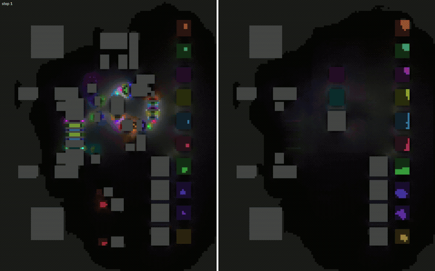

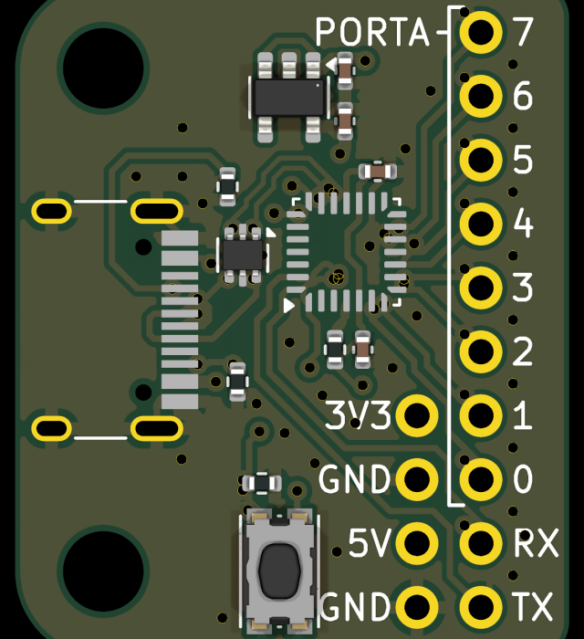

`fun/physarum_route.py board.kicad_pcb --video out.mp4 --write-pcb`: Tero, Kobayashi and Nakagaki's Physarum solver
(J. Theor. Biol. 2007; the Tokyo-rail version Science 2010) on a KiCad board. The board's two outer layers
are a grid (cell = longest side / 250, 0.2-0.5 mm); every net is a slime mould: a conductance field D (tube
thickness) on the free cells, a pressure field p, one pad the sink (p = 0), the other pads injecting unit flow,
div(D grad p) = s, the flow through each cell q feeds back as dD/dt = q^1.5 - D. Tubes that carry flow fatten,
idle ones vanish and are pruned from the system; the net converges to a shortest tree between its pads (octile
metric: 8 neighbours, diagonals cost sqrt 2; vias are the edges between the layers, priced as a few mm of
track). Nets compete: where other nets' flow exceeds the cell's track capacity a net's tubes are damped
(exp(-kappa x excess), with a random per-net willingness to yield so two equal nets do not stay tied).
The pictures above are the usb_mini_io board (20 signal nets, 0.2 mm cells; power nets and their hand-routed
tracks are kept and are obstacles): the plasmodium spreads over the whole reachable region in the first step,
lens-shaped flows form, and by step 25 every net is one crisp tube. Then three rounds of rip-up: the most
contested nets regrow around the others, with the crowding they met kept as a history (PathFinder's trick).
`--write-pcb` traces every tube down its pressure gradient from pad to pad, smooths the polyline (Chaikin) and
writes it as `segment`s and `via`s into a copy of the board, which KiCad 10 opens as is: the second picture
is KiCad's own 3D render of that file (press B in KiCad first: the zone fills in the file are the old ones).
17/20 nets connected, 7 s on the CPU for 160 steps; the three others have a pad that no 0.2 mm track can leave
at this grid (a switch pad between GND copper, two header pins next to kept tracks: `--cell 0.1` frees one).
DRC is not clean, and will not be: neighbouring pins' tubes run side by side one cell apart (D+/D-, A0/A1
...), which with 0.2 mm tracks is a short; the crowding term keeps tubes a pitch apart only statistically,
and `--walls` (ripped-up nets regrow with the other tubes as hard walls) trades those shorts for nets that
cannot connect at all. Obstacles are modelled honestly (pads plus clearance plus half a track, the kept nets'
tracks and vias the same way), so what remains is tube-versus-tube geometry. The tubes are a topology; the
geometry is a real router's job (topor).

What came out of a day of making it converge, each one a wrong picture:
* **the pressure solve must be exact.** A few relaxation sweeps per step (SOR, even conjugate gradients) stall
  once tubes form: the system is stiff (1 : 10^-3 conductances) and a half-converged p gives spread flows that
  keep the tubes spread. Per net, one sparse direct solve per step (`scipy.sparse.linalg.splu`); pruning dead
  cells keeps it small (a 20-net board: 200k active cells at step 1, 2k at step 25);
* **the sources must stay put.** Alternating source and sink (or Tero's random pairs) with a warm-started
  iterative solve never converges; with direct solves the sink rotates among the pads every 20 steps;
* **mu > 1, dt 0.7.** With mu = 1 the flow spreads over the many equal-length octile paths; with
  normalised D and a floor the feedback died (q^mu below the floor everywhere); the absolute model with
  dt = 0.7 converges in ~25 steps;
* **pads of one net that overlap in the raster are one terminal** (USB-C A6/B6, stacked pads): as two
  terminals the source feeds the sink directly and half the flow is "lost" (arrival 0.5);
* a pad's clearance ring blocks other nets only, and where two rings overlap (the gap between fine-pitch
  pads) the cell goes to the nearer pad, else the pad is walled in; the copper itself plus half a track blocks
  everyone (else the exported tracks overlap the neighbouring pad: shorts).

The same on a real badge, the BornHack 2026 Cyber Ægg (4 layers, 610 pads; the 118 signal nets routed on the
two outer layers, power on its planes left alone), `--video --write-pcb --write-pro`, 2.5 minutes:

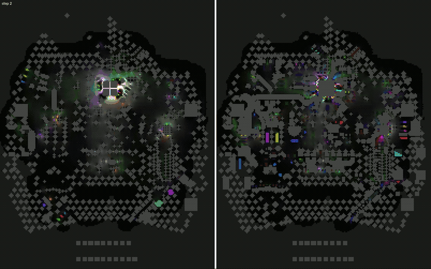

| | |
|---|---|
| 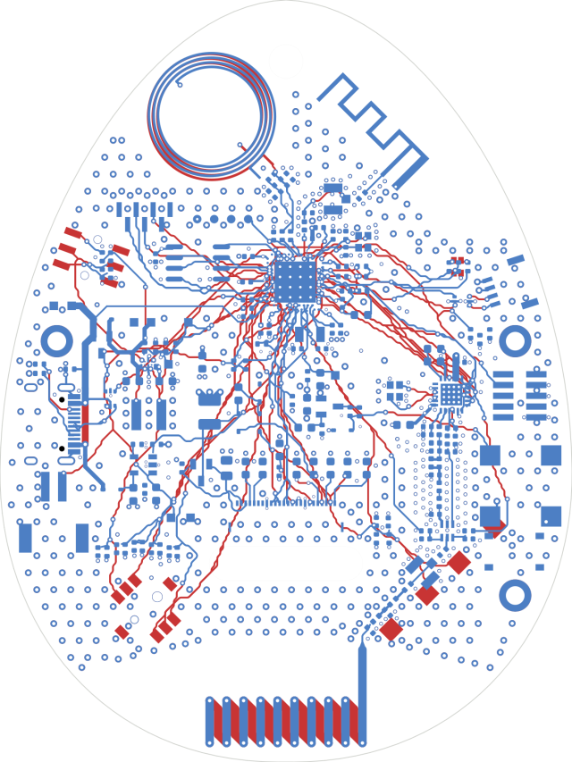 F.Cu red, B.Cu blue, zones hidden: 116/118 nets, 16672 segments, 145 vias | 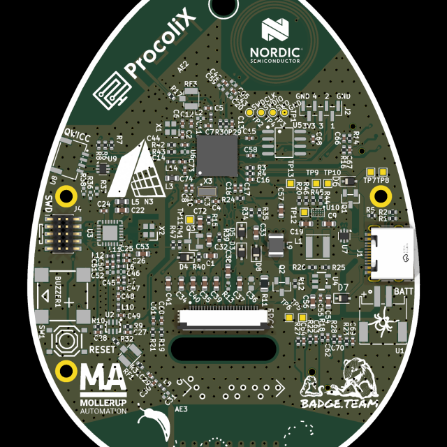 the file in KiCad's 3D viewer, bottom side |

The HackerHotel 2027 star badge (924 pads, a 20x20 LED matrix whose nets stay as hand-routed, `--max-pads 8`;
the 49 signal nets at 0.3 mm cells; the Edge.Cuts star is the routable region): 48/49, 7 minutes.

| | |
|---|---|
| 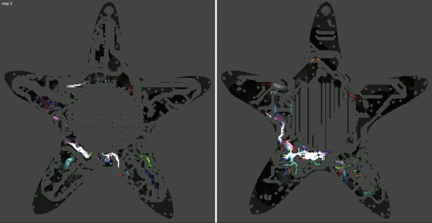 | 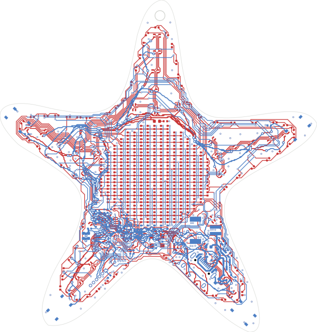 25201 segments, 206 vias; red F.Cu (the matrix is the original), blue B.Cu |

Three more lessons from the three badges, each a wrong picture or a net that gave up:
* **prune by flow, and never a terminal off.** Pruning by tube thickness cut far pads off: their flow starts
  spread over dozens of cells, each too thin, and all died in one step. A cell now dies only when it carries
  less than 1 % of one terminal's flow, and a pruning that would disconnect any pad from the sink's component is
  reduced to the cells carrying no flow at all (one `scipy.ndimage.label` per net per step);
* **the crowding damping needs a floor** (1e-3): `exp(-40)` next to kept copper made the matrix singular for a
  pad whose only exit crossed the crowd;
* **the board is its Edge.Cuts outline**, not its box: lines, arcs, rects, circles and polygons, also inside
  footprints (the egg is a footprint), chained into loops; the largest is the board, the others cutouts. Before
  that the star's tubes swung outside the star.

Honest view: this is a global estimate with a drawing, not a DRC-clean router (obstacles: pads with their
clearance, the board box, the kept nets' tracks and vias; zones and inner layers are ignored), and the NPU plays
no part: a sparse direct solve is the opposite of a stencil. The physics gives order-free simultaneous routing
with congestion feedback, which is what topor's PathFinder loop also does. What it is good for: the animation,
the organic look, and `--write-pro`: per net the flow-weighted length, its stretch over the straight
pad-to-pad distance and how much competition it meets along the way, binned into `topor_p1..p3` net classes
(`netclass_assignments` in a copy of the project file) for topor's routing order.

## Credits and licences

* The code in this repository is MIT (`LICENSE`), Copyright 2026 Anne Jan Brouwer. It was written
  with Claude Code; the commit trailers name the agent.
* One exception: the `Detector` class in `fun/yolo_cam.py` is adapted from the mlir-aie example
  `programming_examples/ml/yolo26n/yolo26n.py`, Copyright 2026 Advanced Micro Devices, Inc.,
  Apache-2.0 WITH LLVM-exception (`LICENSES/Apache-2.0-WITH-LLVM-exception.txt`).
* [mlir-aie](https://github.com/Xilinx/mlir-aie) 1.4.5 (IRON, aie_api, the stock examples run
  here), the Peano compiler ([llvm-aie](https://github.com/Xilinx/llvm-aie)) and
  [XRT](https://github.com/Xilinx/XRT) are AMD/Xilinx projects under Apache-2.0 (with the LLVM
  exception where it applies); none of them is vendored, `setup.sh` fetches them.
* YOLO26n and its checkpoint are [Ultralytics](https://github.com/ultralytics/ultralytics)' (AGPL-3.0).
  Neither the checkpoint nor the quantized parameters derived from it are in this repo, and no
  ultralytics code is; the model runs through AMD's example. The class names are COCO 2017's.
* `docs/img/yolo_coco.png` is COCO 2017 image 30 (coco128) with the NPU's boxes drawn on it:
  "Untitled" by julie (flickr.com/photos/roosterfarm/3573516590), CC BY 2.0, modified (boxes and
  labels added); COCO itself: Lin et al. 2014, annotations CC BY 4.0.
* Measurements and findings quoted from
  [ghost-intuit/xdna2-npu-experiments](https://github.com/ghost-intuit/xdna2-npu-experiments)
  are theirs, CC BY 4.0.
* HRTFs: the MIT KEMAR compact set, Copyright 1994 MIT Media Laboratory, W. G. Gardner and
  K. D. Martin, "HRTF Measurements of a KEMAR Dummy-Head Microphone", MIT Media Lab Perceptual
  Computing TR 280 (https://sound.media.mit.edu/resources/KEMAR.html); downloaded on first run,
  not redistributed.
* Algorithms are cited in each script's docstring: Lenia (Chan 2019), Physarum agents (Jones 2010), the
  Physarum solver (Tero, Kobayashi, Nakagaki 2007; Tero et al. 2010),
  the Gordon-Smith "magic circle" oscillator, Visscher's scheme, Gray-Scott/Pearson, Onsager and
  Yang, Greenberg-Hastings and Griffeath's cyclic CA, Bak-Tang-Wiesenfeld, Quilez's SDF articles
  and Hart's sphere tracing, Karplus-Strong, LifeWiki's pattern catalogue.
* The drum loop used for the reverb and resynthesis demos is not included; use any 48 kHz wav.

## Gotchas

### Kernel source edits can run stale on the NPU

`@iron.jit` caches a compiled design by the jit function's **name, bytecode, constants,
closure and `CompileTime[...]` kwargs**. The C++ text handed to
`ExternalFunction(source_string=...)` is **not** in the key when it lives in a
module-level string (`KERNEL`, `CELL`, `STEP`, `KSRC` ...), because only the global's
name is in the bytecode, not its value. Editing that string and rerunning in the same
process (or against the on-disk cache in `~/.npu/cache`, override with `NPU_CACHE_HOME`)
runs the **old binary** without any warning. Three different kernels measured identical
timings this way before a `variant: CompileTime[str]` argument was added and the real
numbers appeared (2.3 vs 26 G ops/s per core).

When a kernel edit "does nothing": bump or add a compile-time argument, or clear
`~/.npu/cache`, before debugging the kernel.

### Run from the repo root

`env.sh` sources `mlir-aie/utils/env_setup.sh`; a sourced script sees the caller's positional
parameters, so until it was fixed env.sh handed its own command line to env_setup.sh as
`<mlir-aie dir> <peano dir>` (absolute script paths failed with `Invalid Peano install directory`,
and every call printed a `realpath` complaint). `env.sh` now clears `$@` before sourcing. The
scripts still expect to run from this directory: `probe/*.py` do `sys.path.insert(0, "fun")`.

### No `python -I`

`-I` drops `PYTHONPATH`, so `pyxrt` (shipped with XRT, not pip) disappears:
`Unsupported device: npu (CPUOnlyTensor is in use: pyxrt is not importable)`.

### Static schedule check before hardware

```python
from pathlib import Path
from aie.utils.compile import remarks            # needs pyyaml (setup.sh installs it)
rep, why = remarks.analyze(ext_fn, "aie2p", Path(".remarks/rem"))   # .remarks/ is gitignored
for key, loop in rep.loops.items():
    print(key, loop.ii, loop.ns, loop.zol, loop.trips)
print(rep.libcalls)                              # __muldi3, __divsi3, __mulsf3 ... = slow scalar paths
```

An II of 1 with `ns` 14 is the best case (one 512-bit load, one op, one store per cycle).
`fun/mandel.py --scalar` is an example of the other end: its int64 multiplies become
`__muldi3` library calls; the 16-lane int32 version with `acc64` is 34x faster per core.

See `mlir-aie/programming_guide/section-4/` and `mlir-aie/skills/aie-kernel-opt/SKILL.md`
for the full optimisation playbook.

## Glossary

* **IRON**: the Python API of mlir-aie (`aie.iron`): Workers, ObjectFifos, `@iron.jit`.
* **Peano**: AMD's LLVM-based compiler for the AIE cores (pip `llvm-aie`); `aie_api` is its C++
  vector library (`aie::vector`, `aie::accum`, `sliding_mac`, ...).
* **aie2p / AIE-ML v2**: the core generation in XDNA2 (`xrt-smi`: "aie2p"); AIE1 is the older
  Versal core many docs and examples still target.
* **Tile rows**: row 0 shim tiles (DMA to host DDR, 2 channels each way per column), row 1 mem
  tiles (512 KB, 6 channels each way), rows 2-5 compute cores. 8 columns, so 32 cores.
* **L1**: a core's own 64 KB data memory (4 banks of 16 KB); neighbours can read each other's.
* **ObjectFifo**: mlir-aie's double-buffered stream between tiles; `split`/`join` through the mem
  tile fan one host stream out to several cores and back; `acquire(n)` gives a sliding window.
* **Dispatch / call**: one host-side run of a compiled design (~160 us fixed cost here).
* **Halo**: the neighbouring rows a stencil needs from the band above and below.
* **Snake**: the 32 cores chained through shared memory so each band's halo rows come from the
  physical neighbour, column by column up and down.
* **Bundle / II / ns / zol**: one VLIW instruction word; initiation interval of a software-pipelined
  loop (II 1 = one iteration per cycle); its stage count; zero-overhead loop. From the compiler's
  remarks (`aie.utils.compile.remarks`).
* **Qn**: fixed point with n fraction bits (Q12 int16: 1.0 = 4096; Q28 int32: 1.0 = 2^28).
* **bf16 / bfp16 / XINT8**: 16-bit brain float (8 mantissa bits); block floating point with a
  shared 8-bit exponent; AMD Quark's int8 recipe with power-of-two scales.
* **MAC / GMAC/s**: multiply-accumulate; billions of them per second.
* **FDTD**: finite-difference time-domain, the explicit wave-equation stencil.
