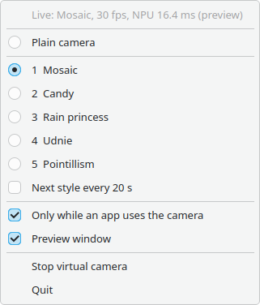
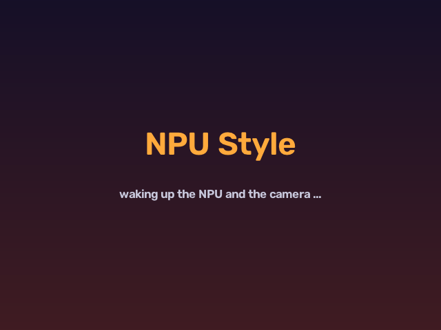

# NPU Style: a virtual webcam painted by the NPU, in the tray

`fun/style_tray.py` puts the webcam style transfer of `fun/style_cam.py` behind a tray icon. Apps (Jitsi, Google
Meet, Zoom, OBS, any browser tab) see an extra camera called "NPU Style". Pick it there and your video call shows
you as a mosaic, a candy painting, a rain princess, udnie or pointillism, painted 30 times a second by the NPU at
about 16 ms per frame.



The webcam and the NPU run only while an app streams from "NPU Style" (or while the preview is open). The rest of
the time the camera light is off, the NPU sleeps, and the program uses 0.2% of one core.

Tested on a Ryzen AI 7 PRO 350 (Krackan), openSUSE Tumbleweed, KDE Plasma 6 on Wayland, v4l2loopback 0.15.4,
with Chrome and ffmpeg as readers. The way the build and the NPU stack are set up is in the
[main README](../README.md).

## Setup, once

1. The repo works: `./env.sh python fun/style_cam.py --selftest` passes, and the five ONNX zoo models are in
   `~/models/style/onnx-zoo/` (see the main README).
2. PyQt6 for the tray side. The tray runs in a normal Python with Qt, not in the `ironenv` venv:

   ```
   sudo zypper in python313-PyQt6        # openSUSE; Debian/Ubuntu: python3-pyqt6; Fedora: python3-pyqt6
   ```

3. The v4l2loopback kernel module, which makes the virtual camera:

   ```
   sudo zypper in v4l2loopback-kmp-default    # openSUSE; other distros: v4l2loopback-dkms
   ```

   `exclusive_caps=1` is required: with it, Chrome and other WebRTC apps list the loopback as a camera.

   For a name of your choice that stays after a reboot, overwrite the package's options. On openSUSE, the
   `v4l2loopback-autoload` package loads the module at boot from `/usr/lib/modprobe.d/98-v4l2loopback.conf` (as
   "OBS Virtual Camera"). A file with the same name in `/etc/modprobe.d/` replaces that file:

   ```
   echo 'options v4l2loopback video_nr=10 card_label="NPU Style" exclusive_caps=1' \
       | sudo tee /etc/modprobe.d/98-v4l2loopback.conf
   sudo modprobe -r v4l2loopback && sudo modprobe v4l2loopback    # or reboot
   ```

   `video_nr=10` keeps the loopback away from `/dev/video0`, so the webcam keeps its usual number. Without the
   autoload package, also add `v4l2loopback` to a file in `/etc/modules-load.d/`. The step is optional. The tray
   finds the loopback under any name and on any `/dev/video*` node.

## Use

```
cd ~/Projects/npu/iron
python3 fun/style_tray.py
```

Use the system `python3` (the one with PyQt6). The tray starts the NPU part itself through `./env.sh`. The first
start after a code change compiles the NPU design (about a minute). After that, it is ready in a few seconds.

Then, in the app: select **NPU Style** (or "OBS Virtual Camera" with the openSUSE default) as the camera. In
Chrome: Settings, Privacy and security, Site settings, Camera, or the camera icon in the address bar during a call.

| action | effect |
|---|---|
| right click | the menu |
| left click | preview window on or off (that turns the webcam and NPU on too) |
| middle click | next style |
| menu: Plain camera | the webcam without a filter, through the same path |
| menu: Mosaic ... Pointillism | the five styles |
| menu: Next style every 20 s | rotate through the five styles |
| menu: Only while an app uses the camera | on (default): webcam and NPU only during a call. Off: always live |
| menu: Stop / Start virtual camera | stop the NPU part completely, or start it again |
| menu: Quit | stop everything |

The top line of the menu (and the tooltip) shows the state, for example
`Live: Rain princess, 30 fps, NPU 16.4 ms (an app is watching)` or `Idle: Rain princess, waiting for an app`. When it is live, the icon shows the painted picture. The style and the check boxes are
remembered (QSettings, `~/.config/npu-iron-experiments/style-tray.conf`).



While no app streams, apps get this card at 5 fps. When an app starts streaming, it sees the card for about two
seconds while the webcam opens, then the live picture.

### Options

| option | default | |
|---|---|---|
| `--vcam DEV` | `auto` | the loopback node. `auto`: the first v4l2loopback device, preferably one with "NPU" in its name |
| `--vcam-size WxH` | `640x480` | the size written to the loopback (the NPU paints 320x240, scaled up) |
| `--camera N` | auto | the webcam's `/dev/videoN`. Auto: the first video capture node that is not a loopback |

### Start at login (optional)

KDE: System Settings, Autostart, Add, Add Application or Login Script, and point it at
`python3 /path/to/iron/fun/style_tray.py`. Or put a desktop file in `~/.config/autostart/`:

```
[Desktop Entry]
Type=Application
Name=NPU Style
Exec=python3 /home/you/Projects/npu/iron/fun/style_tray.py
X-KDE-autostart-after=panel
```

## Problems

| symptom | cause and fix |
|---|---|
| `Stopped` with `no v4l2loopback device` | the module is not loaded: `sudo modprobe v4l2loopback exclusive_caps=1` |
| notification `cannot open camera 1 (is another app using it?)` | another app has the real webcam open (often a browser tab that was given "Integrated Camera"). Select "NPU Style" there instead, or close it. The tray tries again every 3 s |
| notification `no webcam found (plug one in?)` | no video capture node except the loopback |
| the app does not list "NPU Style" | the module was loaded without `exclusive_caps=1`, or the tray is not running (with `exclusive_caps=1`, apps see the loopback only while it is written to). Some apps read the camera list only at start: restart them |
| `--camera 10 is a v4l2loopback node, not a webcam` | `--camera` points at the loopback itself. Leave it out |
| the tray icon does not appear | the desktop has no StatusNotifier tray (GNOME needs the AppIndicator extension) |
| `ModuleNotFoundError: PyQt6` | started with `./env.sh python`. Use the system `python3` |

## How it works

Two processes. The tray (Qt, system Python) starts a child in `ironenv`,
`./env.sh python fun/style_tray.py --child`, that owns the webcam, the NPU and the loopback. They talk in JSON
lines over the child's stdin and stdout (`style`, `cycle`, `auto`, `preview`, `quit` one way; `ready`, `status`,
`error`, `bye` the other way). The frames for the icon and the preview go through a 230 KB file in
`$XDG_RUNTIME_DIR` with a sequence counter around each frame (odd while it is written), so a half-written frame is
skipped, not shown.

When to run: v4l2loopback sends the writer a private V4L2 event, `V4L2_EVENT_PRIVATE_START + 0x08E00000 + 1`, with
the number of readers: 1 when a reader calls `STREAMON`, 0 after its `STREAMOFF` or close. The child subscribes to
it (with `V4L2_EVENT_SUB_FL_SEND_INITIAL`) and waits on `POLLPRI`. On older modules without the event, it stays
live.

Measured: through a real loopback, a reader gets 640x480 YU12 at 30 fps, with the NPU at 16.2 ms per frame.
From idle to live: the card for about 2 s while the webcam opens on its own thread (the first frame takes 0.27 s
on a warm camera), then the first NPU call after the NPU's 5 s autosuspend takes 100 to 270 ms. Its result is
bit-exact with that of a warm NPU. Idle: 0.2% of one core. Converting the card to I420 on every write cost 4%,
because OpenCV's worker threads spin after each call. So the card is converted once.

What can go wrong, and what the code does about it:

* A camera reader thread that is still inside `cap.read()` when Python exits aborts the process
  (`terminate called without an active exception`). The camera thread opens, reads and releases the camera
  itself, and is joined. OpenCV's select timeout is set to 1 s (`OPENCV_VIDEOIO_V4L_SELECT_TIMEOUT`, default 10 s)
  so that a stalled read cannot block the exit.
* Ctrl-C during an NPU call raises `KeyboardInterrupt` inside XRT
  (`xrt::run destructed while command is still in progress`). SIGINT and SIGTERM only set a flag.
* The webcam is found by its driver, not as index 0. After a reboot, the openSUSE autoload can put the loopback
  on `/dev/video0` and the webcam on `/dev/video1`. A loopback taken for the webcam would feed the filter its own
  output.
* If the NPU part stops, the tray says why in a notification and the menu, the icon turns grey, and "Start
  virtual camera" starts it again.
